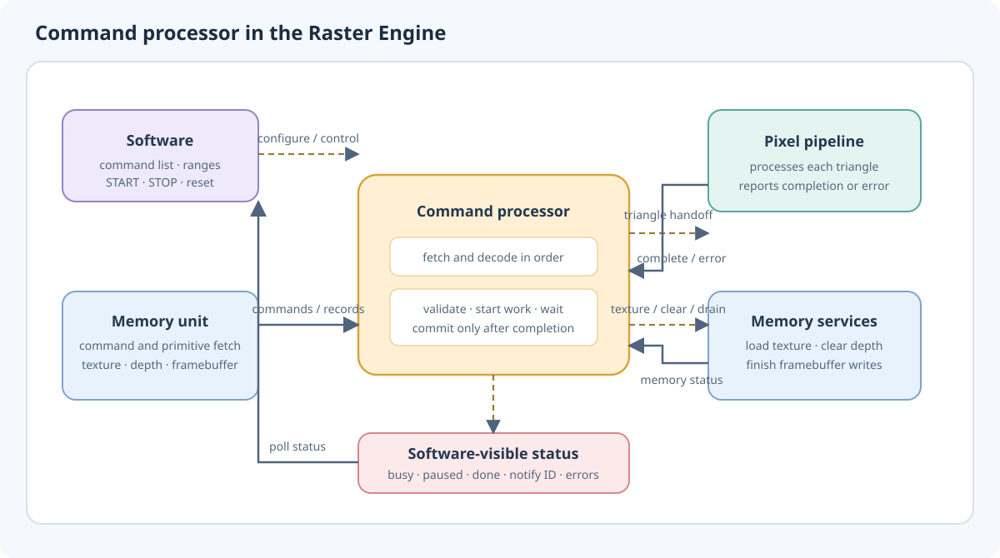
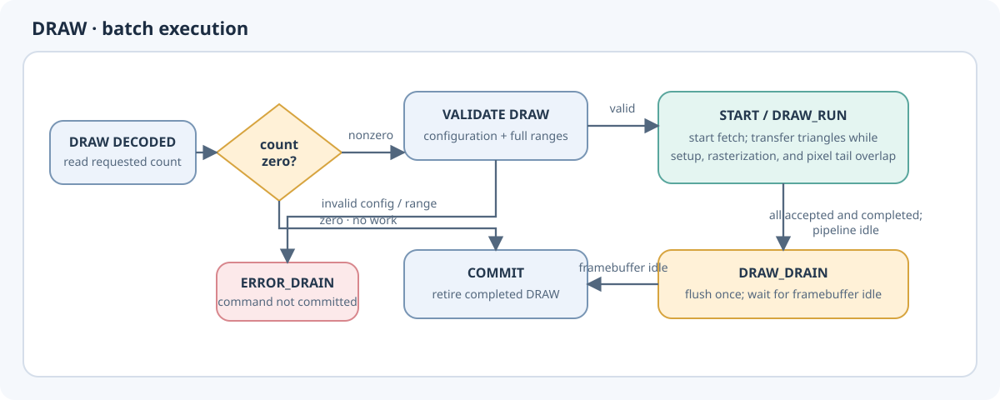
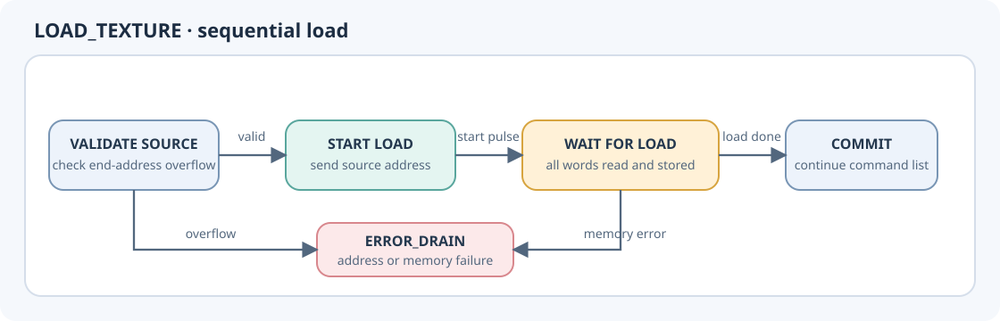
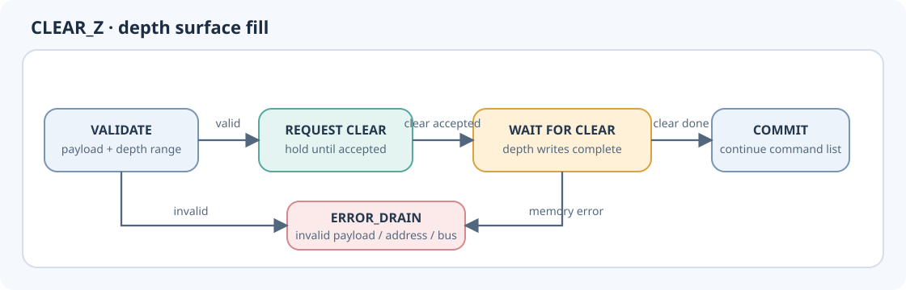
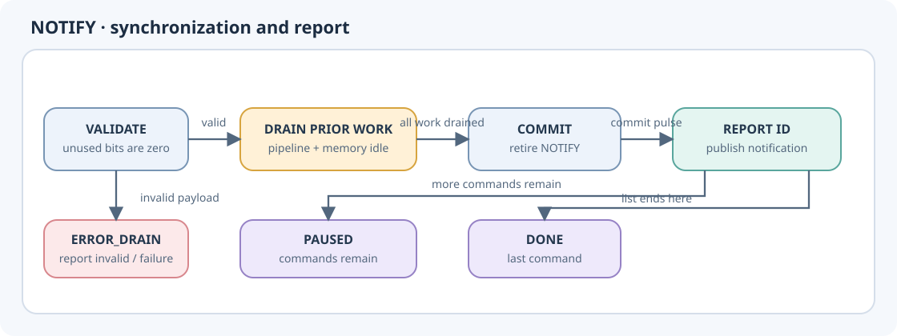

Command processor
=================

The command processor runs a program stored in memory and coordinates the
Raster Engine while each instruction completes. It fetches commands in order,
checks that they are meaningful for the current configuration, starts the
requested work, and advances to the next command only after that work is
complete. This keeps commands simple: a DRAW can describe a batch of
primitives, while texture loading, depth clearing and notifications each have
their own completion point.

The processor is the control point between the command stream, the memory
unit, the pixel pipeline and software status. It does not render triangles
itself or move pixel data. Instead, it starts those operations and waits for
the relevant blocks to finish before retiring the command.

Passthrough mode adds one ``STREAM_RUN`` state. START validates rendering
configuration and surfaces, then accepts the direct GE source through the
same primitive handshake without issuing command or primitive reads.
End-of-stream uses the existing drain/completion states; STOP, reset, and
errors also reuse the normal controller paths. See :doc:`../integration`.

Program setup and command stream
--------------------------------

Software provides the command-list range and the memory ranges used by
primitives, depth, and the framebuffer. On START, the processor checks that
the command and primitive ranges are aligned and ordered, then begins at the
start of the list. Before a DRAW, it checks that the entire requested
primitive batch fits in the primitive range and that the active rendering
configuration and required surfaces are valid. This prevents a malformed
batch from partially entering the pipeline.

Commands occupy one word and execute in increasing address order. The
processor handles one command at a time: after fetching one, it decodes the
operation and waits for that operation to finish before committing the
command and fetching the next. The command pointer therefore marks the
current command until successful completion. See :doc:`commands` for the
command encoding and payload fields.

Executing commands
------------------

**DRAW** sends the requested primitive count to the memory unit. The memory
unit fetches triangle records and presents them to the pixel pipeline. The
processor transfers each triangle whenever setup can accept it. Setup of the
next triangle overlaps rasterization of the current one; its final pixels can
also overlap the start of the next rasterization. Triangles complete in order.
The processor counts accepted and completed primitives, then flushes the
framebuffer once at the end of the DRAW, before committing the command.
An empty DRAW has no primitives to fetch and completes immediately.

**LOAD_TEXTURE** starts a texture load from the command's source address. The
processor waits until all texture data has been read and written to texture
memory before continuing. The source address must be aligned, and the full
load must fit in the address space.

**CLEAR_Z** asks the depth service to fill the active viewport with the
specified depth value. It first checks the depth surface range and alignment,
then waits for the clear operation and its memory writes to finish.

**NOTIFY** is a synchronization point for software. Before reporting it, the
processor waits for the pipeline and memory work already started by earlier
commands to drain, including pending framebuffer writes. It then reports the
notification ID. If commands remain, execution pauses after the NOTIFY; if
the command ends the list, execution completes instead. Reaching the end of
the list without a NOTIFY also waits for outstanding work before completion.

Pause, resume, and errors
-------------------------

STOP or clearing the enable setting requests a pause at a command boundary.
The command already in progress is allowed to finish. For a DRAW, that means
finishing the whole primitive batch. The processor then drains outstanding
work and reports the paused state. START resumes at the next command, keeping
the saved command and primitive positions. The command and primitive ranges
must still match the ranges used when execution was paused; rendering
configuration may be changed before resuming.

Unknown commands, invalid command payloads, invalid rendering settings,
out-of-range addresses, and failures from rendering or memory are reported
through status errors. The command that failed is not committed, so its
address remains available to software when diagnosing the list. The processor
halts after draining or aborting dependent work; software reset is required
before starting again.

Software reset aborts pipeline activity, discards local framebuffer state,
and returns command execution to its initial state. A memory transaction
already reserved by the memory service continues through DDR acceptance and
must receive its response before the service is idle. This prevents a late
response from an old execution from being mistaken for work from a newly
started list.

The page :doc:`command_processor_details` retains additional interface and
integration notes for the complete Raster Engine.

.. toctree::
   :hidden:
   :maxdepth: 1

   command_processor_details
