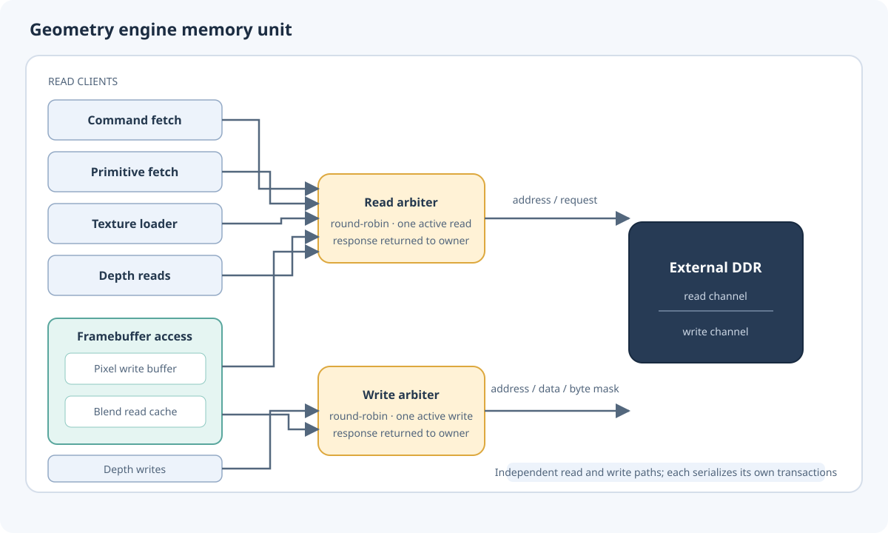
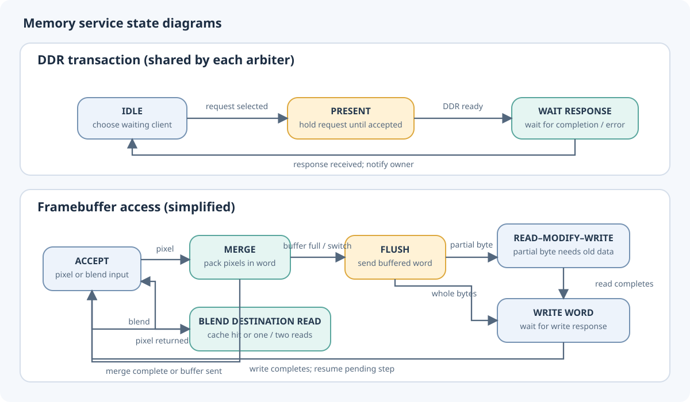

Memory unit
===========

The memory unit connects the raster engine to external memory and to the
small texture RAM used by the drawing pipeline. It serves several kinds of
traffic: command words, triangle records, texture data, depth values, and
framebuffer pixels. These clients can make progress independently, while
separate read and write paths arbitrate access to DDR. A response is returned
to the client whose request was accepted.

The unit also tracks where command and primitive streams should continue,
checks memory ranges for framebuffer and depth accesses, and reports when its
work has drained. The framebuffer path is special: pixels are packed into
memory words, neighbouring pixel writes can be combined, and partial words
are preserved by reading their old contents before writing them back.

The drawing pipeline normally supplies work to these paths in parallel. A
command fetch can overlap with primitive or texture reads. Depth traffic and
framebuffer traffic can also proceed independently, subject to each path's
arbitration. Within either DDR path, however, only one transaction is active
at a time.

Command stream
--------------

The command path reads aligned memory words and presents one 32-bit command
word at a time. If the stream begins partway through a memory word, earlier
words in that beat are skipped. The final beat is trimmed at the configured
end of the command range. Fetching a command does not by itself advance the
stream: the command pointer advances when the command is committed, so a
stalled or rejected command can be fetched again.

Initialization positions the command pointer at the configured command base.
Execution reset returns it to zero. Aborting or invalidating execution clears
the buffered fetch state, so stale prefetched words cannot be consumed.

Primitive stream
----------------

Each triangle occupies four consecutive 128-bit memory words. The primitive
path gathers those words into one record, then holds the record until the
downstream pipeline is ready to accept it. It reads ahead by at most one
triangle and starts another only after the current one has been consumed.
The primitive pointer advances by one triangle on that transfer, not when the
memory request is made.

The draw processor validates a draw's full address range before enabling
primitive reads. This lets the fetch path work sequentially without checking
every triangle against the range again.

Texture loading
---------------

Texture loading reads a contiguous sequence of memory words and writes each
successful response into texture RAM. The destination address maps compact
texture rows into the RAM's fixed row stride. The configured texture size
determines how many words are loaded. When the last word arrives, the path
signals completion; an unsuccessful read does not get written into the RAM.

Depth access
------------

The depth port accepts a single read or write request from the raster stage.
It allows only aligned 16-byte accesses that end at or before the configured
depth-memory end address. Valid reads use the shared read path, and valid
writes use the shared write path with a 16-byte mask. The ready signal
indicates that the chosen path accepted the request; the response signal
marks its completion.

Framebuffer and blending
------------------------

The framebuffer stores RGB444 pixels: each pixel occupies three four-bit
channels, packed consecutively in memory. The selected viewport determines
the row width. Each row begins on a 16-byte boundary, and the coordinates are
translated into a byte address and a position within its 128-bit memory word.
The surface base must be aligned, and every access must stay within both the
viewport and the configured framebuffer end address.

The two modes use 60 or 30 memory words per row. Both the writer and the
blending reader calculate the word index as
``y * words_per_row + floor(3*x / 32)`` and the bit offset as
``4 * ((3*x) mod 32)``. The row product uses shifts and subtraction;
the division and remainder select bits. No variable width multiplier is
needed, and the bit offset depends only on X.

**Writing pixels.** A pixel transfers when its valid signal and the path's
ready signal are both asserted. Ready can pause while the path sends a word
to memory, providing backpressure to the pixel producer. On acceptance, the
path places the pixel's 12 bits into a pending word and marks the bits that
belong to that pixel. Most pixels fit in one 128-bit word. At the last
few positions in a word, a pixel crosses the boundary; the path writes its
first part into the current word, then carries the remaining bits and mask to
the next word.

A one-word buffer combines successive writes that target the same word. The
buffer stays local while more pixels can be merged into it. If a new pixel
targets a different word, the old word must be sent first and the pending
pixel is held until that finishes. A full buffer or an explicit framebuffer
flush also sends it. The command processor requests that flush at the end
of DRAW, so successive triangles can share a partially filled word. This
batching reduces DDR writes while preserving the order of the pixel stream.

The buffer tracks which bits have changed and turns that information into a
16-byte write mask. When every changed byte is complete, the word can be
written directly with the corresponding byte enables. If a pixel changed
only part of a byte, the path first reads the old word, overlays the new
bits, and writes the merged word. This read-modify-write step preserves the
other channel bits that share that byte. The buffered changes are cleared
after the write response arrives.

**Reading a destination for blending.** A blend request transfers when its
valid and ready signals are both asserted, and uses the same coordinate
mapping as a pixel write. If the write buffer contains newer pixels, it is
flushed before the destination is read, so blending sees the latest
framebuffer contents. Otherwise, the path checks a one-word read cache. If
the pixel fits in the cached word, the 12-bit value is returned without a
DDR read; on a miss, the containing word is read and saved in the cache. A
pixel that crosses a word boundary is assembled from both words, fetching
the second word when needed. A write to the cached word or a flush
invalidates the cache so a later blend cannot use stale pixel data.

The destination pixel is held valid until the blend stage accepts it. While
the path is servicing a blend request, it does not accept a new pixel write;
if pixel and blend requests arrive together, the blend request is considered
first. Invalid coordinates or an access beyond the configured framebuffer
end raise an address error and stop normal framebuffer service until the
path is reset. Execution cancellation drops an in-progress blend read and
stops new pixel and blend inputs, while already accepted pixel work may
finish. A framebuffer flush is the operation that commits buffered pixel
writes to memory.

DDR arbitration
---------------

Read clients share one round-robin arbiter: command fetch, primitive fetch,
texture loading, depth reads, and framebuffer reads. Depth writes and
framebuffer writes share a second arbiter. The arbiters select waiting clients
in rotating order, keep the selected address and write data stable while DDR
accepts the transaction, then route its completion and error indication back
to that client. They do not accept a second request until the current response
has arrived.

An abort stops new requests at the clients and clears fetch-side buffered
state. Transactions already in flight are allowed to complete. Discarding
the framebuffer also blocks new DDR requests through the arbiters.

The transaction diagram shows the shared arbiter's request lifecycle. The
framebuffer diagram summarizes the local path: it accepts pixels or blend
requests, merges and flushes writes as needed, and performs read-modify-write
or destination reads when required. A flush can resume the pending pixel
merge or blend read that caused it. Error handling and reset can return the
framebuffer path to its accepting state.

Completion and errors
---------------------

The memory unit is idle when both DDR paths are idle, the framebuffer has no
pending work, and no texture load remains active. Address errors are reported
for out-of-range framebuffer accesses, invalid depth requests, or errors
returned by either DDR path. A framebuffer flush can be used to ensure its
buffered pixel writes have reached memory before software treats the surface
as complete.
