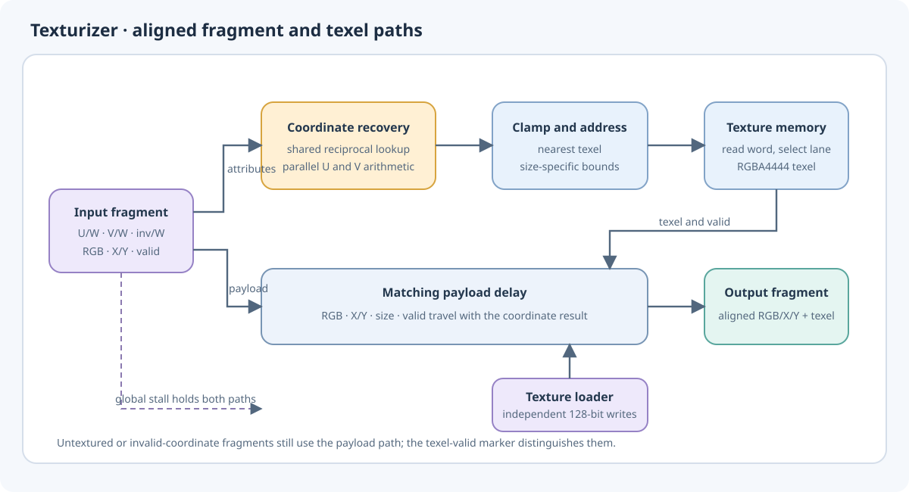
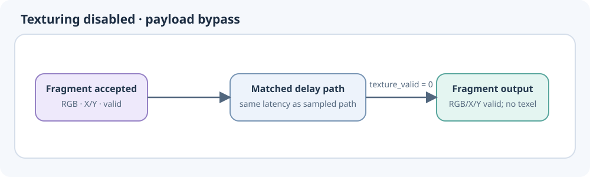
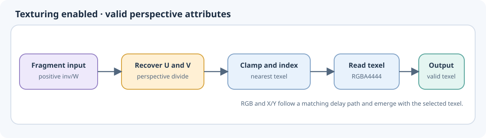
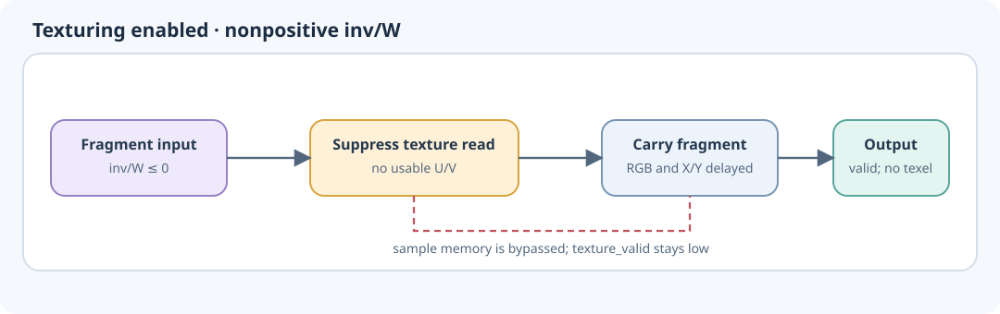
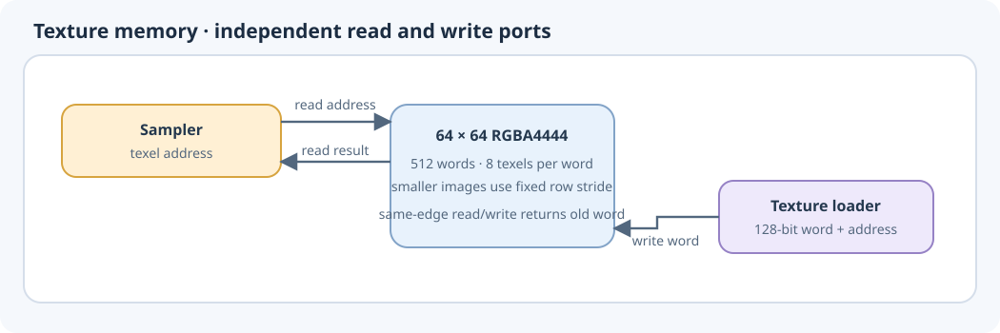

Texture sampling
================

The texturizer adds one point-sampled texture value to each fragment while
preserving its position and interpolated color. For textured fragments, it
recovers the texture coordinates from their perspective-weighted values,
selects one texel, and returns that texel beside the original fragment. The
pixel blender can then combine the color and texel. The texturizer does not
mix colors or test alpha itself.

In the integrated raster pipeline, RGB has already been saturated to the
blender's channel range after interpolation. It travels through the depth
and texture stages as unsigned 16-bit F12, retaining every fractional bit.
The standalone texturizer defaults to preserving signed 36-bit F12; its
``CLAMPED_COLOR`` parameter selects the narrow interface used by the GPU.

This block is a fixed-latency pipeline rather than a command-driven state
machine. It can accept consecutive fragments, and all values belonging to a
fragment travel together so the returned texel cannot drift onto a different
pixel. The diagrams below show the whole path and the distinct behaviors for
bypass, valid sampling, and an invalid perspective denominator.

Fragment and coordinate paths
------------------------------

Each fragment carries screen position, interpolated RGB, and perspective
attributes. When texturing is enabled, the coordinate path divides the
weighted U and V values by the interpolated reciprocal depth. This recovers
normalized texture coordinates. The calculation uses a shared reciprocal
lookup and parallel arithmetic for U and V; it is approximate and rounds the
coordinates before sampling. The technical notes describe its numeric
format and rounding in detail.

The position, RGB values, texture size, and valid marker take a matching
delay path alongside the coordinate calculation. A global stall holds both
paths together. When texturing is disabled, the fragment still takes this
same path and latency, but no texel is requested. This keeps fragment order
and output timing consistent across textured and untextured draws.

Sampling a texel
----------------

U and V are normalized coordinates. Each is scaled by the selected texture
dimension and rounded down to choose a texel. Coordinates below zero select
the first texel, and coordinates at or above one select the last. Sampling is
nearest point only: there is no wrapping, filtering, or mipmap selection.

The returned texel is a 16-bit RGBA4444 value. Its RGB channels and alpha are
kept intact for the next stage. The texturizer marks the texel valid
separately from the fragment, allowing an untextured or invalid-coordinate
fragment to continue without a texture value.

If the reciprocal depth is not positive, the coordinate is undefined for
sampling. The texel read is suppressed and the texel-valid marker remains
low, but the original position and color still emerge as a valid fragment.
This is distinct from a pipeline stall, which holds the entire fragment until
the downstream path can advance.

Texture storage and loading
---------------------------

Texture data is stored as 64 by 64 RGBA4444 texels. Smaller textures use the
upper-left part of that allocation, with each row retaining the same physical
stride. The sampler reads a 128-bit word and selects one of its eight texels.
The loading interface writes complete 128-bit words independently of
fragment stalls; software or the texture loader must finish loading the
texels that will be sampled before they are needed.

The read and write ports can operate at the same time. If both access the same
word on one clock edge, that read returns the old contents; later reads see
the new data. Loading is therefore not atomic across a whole texture. Drain
the pixel pipeline before replacing texture contents when one draw must use
one consistent image.

Pipeline timing
---------------

The complete path takes ten advancing clock edges from fragment acceptance
to output. It can accept one fragment on every advancing edge and preserves
bubbles in the input stream. A stall pauses coordinate arithmetic, payload
alignment, texture addressing, and read results together; valid output stays
asserted while held. Reset clears fragments in flight but does not erase the
texture contents.

The page :doc:`texturizer_details` retains numeric formats, exact RAM layout,
interface timing, and integration notes.

.. toctree::
   :hidden:
   :maxdepth: 1

   texturizer_details
